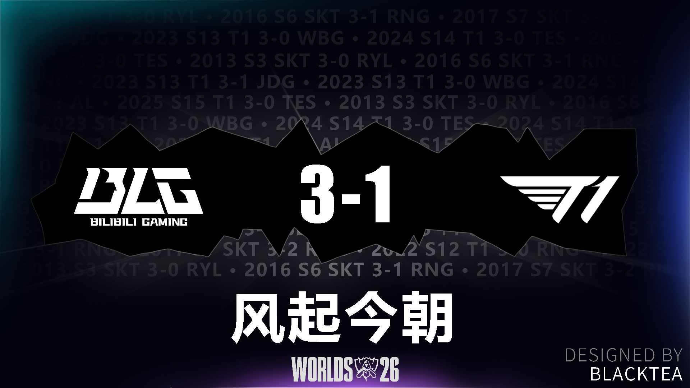

终于！！！

BLG 做到了！！！！

我是从冰岛 EDG 夺冠那年开始看的，

当年夺冠的时候，还是高中上网课的时期。

我还记着我正在做生物作业来着。（可能不太准了）

当时真的很激动！似乎夺冠的时候，好多人在喊 EDG nb。（而且是半夜）

虽然我只是云玩家，压根看不懂游戏怎么玩。

但是我真的感觉到了比赛的 Passion，于是我开始喜欢看比赛。

当时是 EDG vs DK，√××√√。

差一点就输掉了。没想到最后竟然夺冠了。

我还记得许哥当年那个表情。~~（凶狠的看向摄像头）~~

结果输了。哈哈哈。

当时，直至今天，T1 在 S 赛的 BO5 依旧对 LPL 队伍保持着 100% 的胜率。

然而，这个 “墙” 在今天就被打破了。

其实也很激动的，当时正在上楼的路上。（3号楼）

13 年了，再不打破都快没机会了（笑

好了，今天也是为了打一个绿点，同时

我给 BLG 的胜利做了个小海报。

纪念这个被打破的 “墙”。

最后，15 号早上 3 点见！

BLG，决赛加油！

