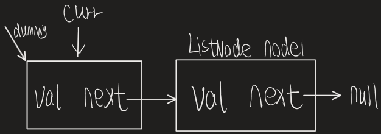
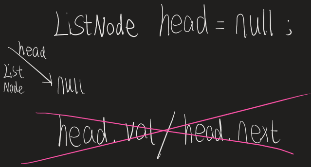
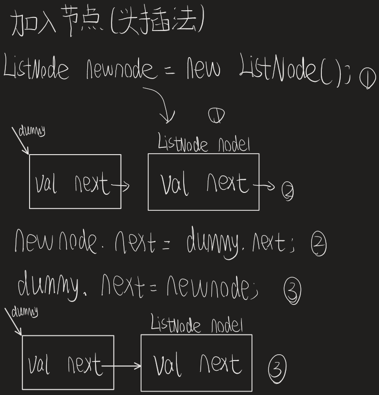
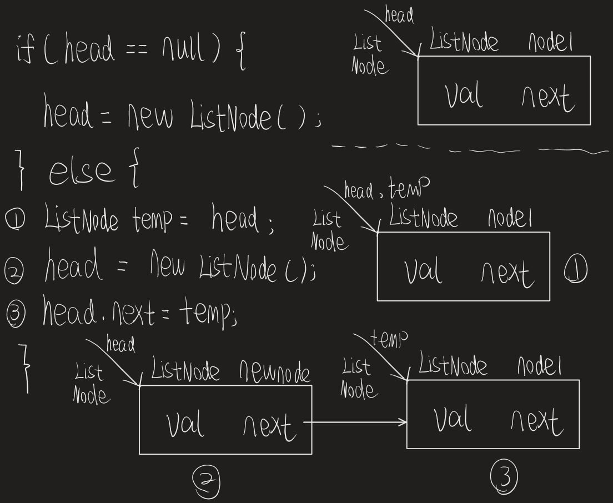
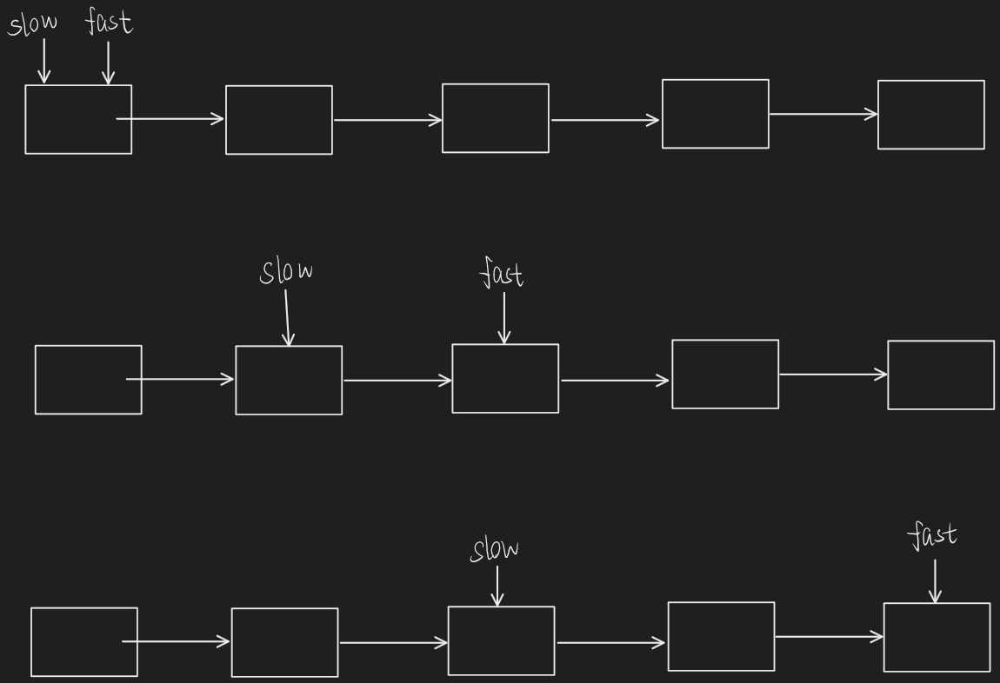

Okay, 第一篇技术(~~可能也没那么技术...~~)博客献给最基础的Linked Lists。

链表是什么就不用多说了吧。

Leetcode中对于链表的定义如下:

```java
public class ListNode {
    int val;
    ListNode next;
    ListNode() {}
    ListNode(int val) {
        this.val = val;
    }
    ListNode(int val, ListNode next) {
        this.val = val;
        this.next = next;
    }
}
```

下面介绍几个链表常用的几个小技巧。

# 一. Dummy Node (哨兵节点)

如果你学过CS61B的前几节课，你应该听说过哨兵节点。(在那里叫sentinel)

没学过也没关系。简单来说，它放在链表的**最前面**，**不存储任何数据**，只保留对下一个节点的**引用**。


什么？你不知道什么是引用？！

那你应该知道指针吧，和那个差不多意思。

emmmm，不会....指针你都不知道...吧。。。

没关系！我正好想给自己整理一下这些基础的东西。

如果你刚复习过或者很熟悉的话，可以点[这里](#why-section)跳过这部分。

## 1.1 引用

写过论文的人，应该都知道什么是引用。

有的时候，我们想把别人文章的内容或者结论放到自己的文章，

但是又不能把**整篇文章**都放在自己的文章里，这时候就需要**引用**。

这里的引用就是在你的文章里，标注另一个文章的出处。

出处可以是那个文章所在的的**网址**，具体在什么期刊的什么**位置**。

简单来说，通过出处，你能找到那个文章的**原文**。

同样，Java 里的引用也是一样。

它存的是某个**对象**具体在**内存**中的什么**位置**。

那为什么 ```int a = 1``` 这种不需要引用呢？

内存分为**栈内存**和**堆内存**，

栈内存**很小**，默认只有1MB(相当于你自己的论文)

但是它非常**快**。

堆内存**很大**，差不多有好几个G(相当于你引用的其他论文)

但是没有栈内存快。

所以，栈内存的空间是很**宝贵**的，不能把所有东西都放在栈内存。

基本类型 ```int``` 占用的空间**非常小**，所以可以放在栈内存。

> 补充：基本类型的大小是固定的，对象不是。
>
> ​            这也是为什么对象不能放在栈内存的原因之一。

但是 Java 里的对象，想占多大就可以占多大。 

下面举个栗子。

```java
String lizi = new String("栗子");
```

其中  ```lizi``` 就是对 String 对象的引用，

也就是说，```lizi``` 里面存储的是后面 String 对象在堆内存中的**地址**。

> [!TIP]
>
> new String 调用了 String 对象的构造函数 String()
>
> 它返回这个新创建的 String 对象的地址。

同样，一个引用只存储**地址**，所以它占用的空间不大，放在了**栈内存**。

但是后面的 String 对象，我可以输入很多很多很多字符，它可能占用很大的空间，

于是把它放在**堆内存**。

> [!IMPORTANT]
>
> 这里有一道经典的面试题， 
>
> String lizi = new String("栗子");
>
> 这段代码实际上创建了几个对象？
>
> 实际上....
>
> 答案....
>
> 竟然是...
>
> 两个！！！(~~我也刚知道。~~)
>
> 感兴趣你可以去搜一下，```字符串常量池```。

说到这里，应该差不多明白什么是引用了吧。

如果不明白的话，去B站找视频看看，可能会更通俗易懂。

下面用 ListNode 再举个栗子。

```java
ListNode listnode = new ListNode(1, new ListNode());
```

这里 ```listnode``` 是对于新的 ListNode 对象的**引用**。

同时这个 ListNode 对象里面的 ```ListNode next``` 存储**下一个** ListNode 对象的**引用**。

如果你不明白的话，我再详细解释下，

ListNode 的一个构造函数是

```java
ListNode(int val, ListNode next) {
    this.val = val;
    this.next = next;
}
```

它需要一个值  ```val``` ，和对下一个节点的引用  ```next``` 。

上面的栗子里，我们传入了 ```1``` 和 ```new ListNode()``` 。

构造函数的参数里面需要一个 ListNode 的**地址**(ListNode next是引用，存ListNode对象的地址)，所以最内层的 ```new ListNode()```  的需要先执行。

之后 ```new ListNode()``` 返回的 ListNode 地址作为**参数**传入构造函数，赋值给参数里的 ```next``` 。

之后在这个构造函数里，```this.next = next``` 

是指将**参数**里的 ```next``` 赋值给这个 ListNode **对象**的 ```next```。

> 这两个 ```next``` 不是同一个 next ！！
>
> 参数里的 next 会随着构造函数退出而销毁。
>
> this.next 是保存在这个对象里的。

也就是将刚才**最内层** new 得到的 ListNode 对象**地址**，传给了这个 ListNode 对象。

这样，当前的 ListNode **对象**就保存着**下一个** ListNode 对象的**引用**。

> **当前**指的是外层的 new ListNode

我们就能通过一个ListNode对象里面的下一个ListNode对象的引用，来找到很多ListNode对象了。

最后，当前 ListNode 对象的构造函数返回自己的地址给 ```listnode``` 这个引用。

它就是这个链表的头，也就是头节点。

从始至终，new 为对象开辟的内存都是在堆内存里面的(包括对象里面的 ListNode next 引用)，

只有头指针 listnode 放在栈内存。

**神奇吧！**

emmmm....

不知道你懂了没，可能说的太乱套了。

中间可能还有些不太对的东西。

Whatever。

也许只是给自己看的。

自己能看明白就行了。

不懂的地方欢迎提问！(我不一定能解答，但是会尽力的。)

（~~会有评论吗？~~）


## 1.2 为什么使用哨兵节点

<span id="why-section">所以，哨兵节点是干什么的呢？</span>

举个栗子！

假如链表是一个**小区**，那么**头节点**就是小区的**入口**。

小区的入口应该有一个**保安**吧。

```Java
ListNode baoan = new ListNode(val, next);
```

假如保安的 ```val``` 是小区的**总人数**，```next``` 指向小区的第一个居民。(居民的 val 存放他们是**第几个**居民)

假设小区的结构是这样的：```baoan->person1->person2.....```

接下来，我想知道小区的人数，只需要用 ```baoan.val``` 就可以了。

如果我想**去掉**小区的第 i 个居民，只需要：

```java
public boolean removeResident(ListNode head, int i) {
    // 因为有保安，所以 head 一定不为null
    ListNode curr = head;
    // 刚开始 head 不为空，所以可以安全.next
    // 为什么是 curr.next != null 而不是 curr != null?
    // 因为这个是单向链表，一旦跳到了下一个节点就没办法回去
    // 如果让 curr 正好指向要删除的节点，就没办法删除了。
    while (curr.next != null) {
        if (curr.next.val == i) {
            curr.next = curr.next.next;
            return true;
        } else {
            curr = curr.next;
        }
    }
    return false;
}
```



如果**没有**保安呢？

还能使用**上面的策略**吗？

```Java
ListNode curr = head;
while (curr.next != null) {}
```

如果 head != null，你可以。

不过 如果 head  == null。

你就 **完蛋** 了。

看看 curr.next，就这样不知不觉的变成了 null.next。

> It's been a long day 
>
> without you my friend.....
>
> 好了，快进到坠机。

有保安的情况下，我可以随时问保安，

你这个小区，他有居民吗？

它保证小区门口永远存在一个保安，

甚至小区都没有，我还是可以问它。

> 这就是为什么他叫 dummy
>
> 英文直译 - 傻瓜。
>
> 又记了一个英语单词。
>
> 我还是在  ```Five Nights At Freddy's - Sister Location``` 里学的呢。
>
> 那个 Baby ！！！
>
> 骗人技术一流。
>
> 扯远了。

如果没有保安呢？

问谁。比较好。。

有居民的情况下可以问第一个居民，

没有居民只能问 null... 了。

但是 null，

他只是个孩子啊！

什么都不懂。。。

你问它 ```.next```

他只会哭着告诉你，

> [!CAUTION]
>
> NullPointerException

舒服了。

所以，如果没有保安，

你需要判断 head == null。

而且删除第一个结点的时候需要直接移动头节点，

有哨兵就不需要，

因为哨兵才是第一个节点。

```Java
public boolean removeResident(ListNode head, int i) {
    if (head == null) {
        return false;
    }
    // 如果删除的是第一个节点， 你还需要直接操作头节点！！
    if (head.val == i) {
        head = head.next;
        return true;
    }
    ListNode curr = head;
    while (curr.next != null) {
        if (curr.next.val == i) {
            curr.next = curr.next.next;
            return true;
        } else {
			curr = curr.next;
        }
    }
    return false;
}
```

你明白了吗？

也就是说，没有哨兵节点并且 head = null 的情况下，

你不能使用 ```.val``` 或者 ```.next``` 或者访问对象内部的东西。

但是有哨兵就可以。

它让你的代码在某些地方可以省略判空的操作。

> 还不快说谢谢哨兵。



下面以头插法再举一个例子。





相信你能看懂我的...潦草的笔记。

加油。

反正就是哨兵节点的不用判空，

不带哨兵节点的头插法，需要你判空，

如果 head == null，你需要给 head 分配一块内存。

差不多就这样。

## 二. 快慢指针

顾名思义，快慢指针就是一个快一个慢的指针。

具体说呢，快指针每次走两格，慢指针一次走一格。

这东西到底有啥用呢？

### 2.1 为什么使用快慢指针

甲乙两队同时施工。

> 对，你没看错。
>
> 咱们返璞归真。

他们在同一起点，向同一方向施工。

甲队负责铺地基，乙队负责铺水泥。

假如一共需要修10KM的路，

甲每天能铺2KM，乙每天能铺1KM。


甲需要：10 / 2 = 5(天) 施工完毕。

此时，乙施工到：1 × 5 = 5(KM) 处。

**不难注意到**， 乙正好完成了**一半**。

> 是真的不难注意到。
>
> 没有注意力惊人。


为什么呢？

因为，甲比乙快了一倍啊。

我觉得，你应该明白快慢指针的**原理**了。

请看 ```Leetcode 876: 链表的中间节点```



甲和乙就是快慢指针。

只不过我们不知道一共要施工多少KM。

但是我们知道，快指针到末尾了，慢指针一定在链表的中间。

怎么样？

> 旁白：对链表的印象**加深了。**

emmmm，不小心入戏了。

接下来，建议你做 ```Leetcode 141: 环形链表```

正文就写到这里吧！

# （>_<）

不知不觉，竟然码了2000字左右了。

刚开始我感觉最多写500-600字，

现在回头一看，好像有一篇小论文的字数了。

现在是2026年。

AI发展的非常快，

我不知道，

以后，

程序员会变成什么样子 :sob:(大哭wwwwwwwwwwwww，~~严肃点，不是大笑的意思~~。)​

人类会变成什么样子:sob:

我以后会变成什么样子:sob:

好吧。

最后，

我希望，

坚持就是胜利。

这句话是对的。

(~~不对的话就去搬砖。。~~)
